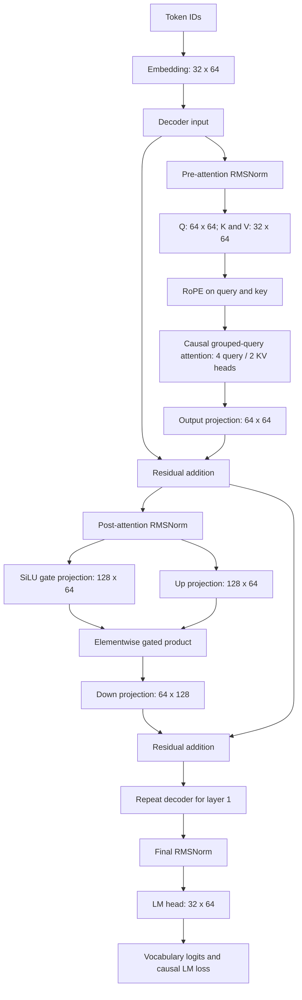

# Native HF Llama workflow and 2.1.0 qualification

For the current **2.2.0 editable component architecture**, read
[LLAMA_BLOCKS.md](LLAMA_BLOCKS.md). **Transformers → + Build Llama from blocks**
creates independent RMSNorm, Q/K/V, RoPE, attention, SiLU, product, projection
and residual blocks, with a trainable graph compiler and custom tensor-operation
support. Their connections replay during training and generation. The native HF
workflow documented below remains available; its existing module inspector and
historical measurements describe that separate `LlamaForCausalLM` path.

The current Node lab editor also provides dtype/rank-aware compatible-port
discovery, advisory width hints, immediate valid inline edits and retained
invalid drafts that block queueing. Inspector and Library panes can collapse at
all screen widths. HF results show visual operation cards, training-loss charts,
token strips and decoded text; **Inspect model visually** opens the same job in
Transformers. Exact output JSON and worker logs are collapsed and rendered only
when expanded. These are current editor controls; the numerical results and
test counts below remain the historical **2.1.0 native workflow** observations.

This project executes the installed Hugging Face **`LlamaForCausalLM`** through the studio's existing configuration, model, tokenizer, training, inference, script and artifact tools. Its 19-node workflow is editable, trains actual weights, exports a safe checkpoint, reconstructs the model, and generates tokens and text. The Transformers view inspects the model's actual modules and tensor shapes.

Open [the studio](http://127.0.0.1:8765/#transformers), choose **Llama decoder training and architecture → Open editable workflow**, then **Validate → Queue workflow**. The template creates a new graph without replacing existing experiments. The completed Llama job in **Observed executions** exposes its architecture, decoder-layer selector, searchable module inventory, loss curve, parameter tensors and checkpoint download.

The portable graph is [llama.workflow.json](examples/transformers/llama.workflow.json). To import it, choose **Node lab → Workflow → Import workflow JSON**. Saving, opening and inspecting a graph do not execute it; queueing is explicit.

## The actual model

| Configuration | Default |
| --- | ---: |
| Decoder layers | 2 |
| Hidden width | 64 |
| SwiGLU intermediate width | 128 |
| Query / key-value heads | 4 / 2 |
| Head dimension | 16 |
| Vocabulary / maximum positions | 32 / 128 |
| RoPE type / theta | default / 10,000 |
| RMSNorm epsilon | 0.000001 |
| Trainable parameters / tensors | **78,144 / 21** |
| Actual instantiated modules | **33** |
| Training optimizer / updates | AdamW / 40 |

All dimensions come from the instantiated native model and its resolved configuration. The model uses newly initialized weights, a local WordLevel tokenizer, and eight educational sentences. No Meta pretrained weights, gated repository access, credentials or downloads are required. This is a small from-scratch Llama architecture; its generated text does not imply the general language capability of a pretrained Meta model. The HF Viewer reference's Llama-3.2-1B is a different model size and checkpoint identity.

The forward structure is:



The attention uses the native library's causal mask, rotary positions and KV-head grouping. The feed-forward branch computes `down_proj(silu(gate_proj(x)) * up_proj(x))`. An optimizer is attached to **Train**, alongside the complete model and tokenized dataset. It is not a layer in the forward path.

The local inspector uses actual `named_modules` and `named_parameters` observations. Its decoder diagram explains the reviewed native Llama implementation; it is not an FX trace of every operation or a separately executing set of diagram cards. Modules and weights remain the actual HF execution authority. Parent/child parameter totals overlap, so sum direct counts rather than summing recursive totals. Inspection is bounded to 256 module rows and reports truncation explicitly for larger models.

## The executable workflow

The main dependency chain is **LlamaConfig → native model → initial inspection/evaluation → AdamW training → trained evaluation/inspection → safetensors export → distinct reconstructed model → reloaded evaluation → forward logits → token generation → text pipeline**. A parallel custom JavaScript block verifies the observed native classes, parameter count and Q/K/V/MLP tensor names.

The tokenizer prepares eight sentences with left padding and causal labels. Padding labels become `-100`; attention masks and token IDs are validated before execution. Three prompt rows drive the final generation. The train node performs 40 full-batch AdamW updates with learning rate 0.003, weight decay 0.01 and gradient clipping at 1.0.

The initial qualified execution measured evaluation loss **3.488792896270752 → 0.29380911588668823** and created **63 optimizer-state tensors**. Safe reload reproduced both the trained weight-state hash and evaluation loss exactly. The exported Python project repeated the execution and reproduced the same final model hash. Those 2.1.0 receipts contain the exact job identities, workflow hash, outputs and artifact identities; those observations establish learning on the supplied small corpus rather than generalization quality.

Edit the **LlamaConfig · editable architecture** node to change dimensions, heads, context, vocabulary, RoPE or bias settings. Keep the tokenizer vocabulary and special-token IDs compatible. Query heads must divide evenly by KV heads, and RoPE requires a positive even head dimension. Explicit `head_dim` is supported when valid. The model budget is checked before real allocation. The default studio budget is 2,000,000 model parameters, with finite tensor/process/memory/job limits. A billion-parameter checkpoint does not fit this delivered local configuration.

The **Custom script · verify native architecture** block intentionally checks this default 78,144-parameter model. Update that script's expected dimensions and tensor inventory when changing the architecture. Its failure is an explicit verification result; it does not mean every valid larger Llama configuration must have the default model's parameter count.

## Save, reload and script it

The checkpoint download is a ZIP containing exactly `model.safetensors`, `recipe.json` and `manifest.json`. Reload reconstructs the native architecture and validates names, shapes, dtype and model-state hash before use. It preserves weights and architecture; complete optimizer/RNG training resume is outside this artifact format.

Use **Workflow → Download runnable Python project** to capture the complete project and selected graph. The exported file is inert on import and requires the installed studio version recorded in its header. Run it explicitly:

```powershell
.\.venv\Scripts\python.exe .\llama-workflow.py --timeout 180 --output .\llama-job.json --artifacts .\llama-artifacts
```

The repeatable qualification script creates a fresh disposable workspace, executes the packaged Llama graph, checks learning and reload state, and optionally runs the exported program:

```powershell
.\.venv\Scripts\python.exe .\scripts\qualify_llama.py --output .\evidence\llama-local --run-python-export
```

The browser's custom tensor language and JavaScript plugins retain their existing execution restrictions. A normal exported Python program can be extended locally with trusted Python code, with the same review responsibility as any local program. Editing a JSON graph does not install arbitrary Python modules into the browser worker.

## Reference and qualification evidence

The user-supplied [HF Viewer repository](https://huggingface.co/spaces/embedl/hfviewer/tree/26aa6d623298cd60ecbc54c527d3ff545793889b) was reviewed at a pinned commit. Its public source supplies a viewing shell backed by an external tracing service. The local inspector was independently authored and does not upload project data to that service. [LLAMA_SOURCE_NOTES.md](LLAMA_SOURCE_NOTES.md) explains the published source, cached reference graph, exact installed HF source, attribution and limitations. The raw external frontend files are kept only as local audit inputs and excluded from the portable source/evidence ZIP; their hashes and upstream URLs remain in the audit receipts.

The historical **2.1.0** evidence directory is `evidence/llama_20261023/`. Important receipts are `llama-verification.json`, `llama.job.json`, the generated Python job/output, runtime test logs, actual-Llama DOM checks, real-browser downloads/screenshots, installed-wheel qualification and project-preservation checks. The earlier 2.0.0 qualification remains in `TRANSFORMERS_REPORT.md` and `evidence/transformers_20261023/`. The 2.1.0 release index identifies that release's distributable bytes; current component qualification and distribution identity belong to [LLAMA_BLOCKS.md](LLAMA_BLOCKS.md).

The **2.1.0 source qualification** passed **401 Python tests**, all **11 execution checks**, **41 graph-model tests** and **40 DOM workflow groups**. Ruff passed across the package and scripts, and mypy passed across **67 Python files**. Its actual browser replay created the Llama template, validated and executed all 19 nodes, selected both decoder layers, filtered the module inventory, and downloaded its observed job, safe model and Python project. That installed-wheel receipt and release index separately bind the 2.1.0 distribution files to their installed execution and byte-comparison results. These counts are historical observations, not new qualification claims for the 2.2.0 component runtime.

See the [Transformers guide](TRANSFORMERS_STUDIO.md) for all generic block contracts and sandbox/resource limits, and the [Node lab guide](NODE_LAB.md) for graph editing, connections, selection and plugin workflows.
