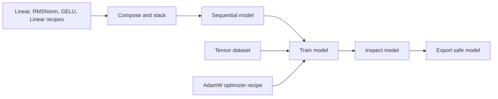

# Transformers Visual Coding Studio

The **Transformers** workspace adds real multi-parameter PyTorch models and Hugging Face Transformers workflows to the studio. Build an architecture from connected layers, construct an HF model from a local config, prepare tensors or tokenize text, train with actual autograd and an optimizer, run inference, inspect parameter tensors, and export safe weights. The original one-scalar observatory remains available for its detailed numerical timeline and bit-level experiments.

Open [the Transformers workspace](http://127.0.0.1:8765/#transformers), or choose **Transformers** in the sidebar. **Node lab** remains the complete graph editor, with all connection, selection, code, import/export, undo/redo, queue, cancellation, and plugin controls described in [NODE_LAB.md](NODE_LAB.md).

This runtime is a local CPU laboratory. It uses actual `transformers`, `torch`, `tokenizers`, and `safetensors` implementations. Models created from config start with newly initialized weights. Fifteen supplied workflows construct models locally without Hub checkpoints, login tokens, or model downloads; one of them requires installing the included custom plugin. A separate cached-checkpoint example loads previously acquired files at a pinned Hub commit; it does not download from inside a workflow. Tiny language-model output demonstrates an executable numerical workflow; it does not imply a pretrained conversational model. Current execution evidence is recorded separately from catalog support.

## Start with a runnable architecture

Choose **+ Build dense architecture** in the Transformers workspace. Select the input and output feature widths, comma-separated hidden widths, activation, normalization, optimizer, learning rate, step count, seed, and JSON tensor data. The wizard creates an editable graph and does not execute it automatically.

For example, use one input feature, hidden widths `8,8`, one output feature, **GELU**, **RMSNorm**, **AdamW**, and:

```json
{
  "x": [[-1.0], [0.0], [1.0]],
  "labels": [[-2.0], [0.0], [2.0]]
}
```

Inspect the generated layer recipes and data before choosing **Validate**, then **Queue workflow**. The model is an actual multi-tensor network; the number of trainable parameters comes from the constructed model rather than an assumed single scalar.

The template gallery creates independent editable workflow copies. Starting points include **Multi-parameter RMSNorm laboratory**, **Tiny offline GPT-2 training and generation**, **Editable tensor forward**, **Llama decoder training and architecture**, **Llama built from editable component blocks**, and its custom-gate variant. The separate [example collection](examples/transformers/README.md) includes complete JSON workflows for connected Llama components, native HF Llama, GPT-2, DistilBERT classification, local text pipelines, safe checkpoint reload, and custom residual attention.

Use a separate storage directory for exploration you do not want mixed into your main project:

```powershell
.\.venv\Scripts\python.exe -m single_parameter_observatory studio --no-browser --port 8766 --storage .studio-transformers-examples
```

Keep that foreground server process running and open its printed local URL. Port 8765 remains the normal studio address; a different port must also be used in the browser URL.

## Llama as editable component blocks

Studio **2.2.0** adds thirteen blocks for an executable tensor graph. Choose
**+ Build Llama from blocks** to set layer count, dimensions, query/KV heads,
corpus, vocabulary capacity, context and training controls in a visual form.
The preview updates for expanded SwiGLU, fused SwiGLU or a custom activation.
Creating the workflow is an edit; **Queue workflow** starts execution.

The component templates connect token/mask inputs, embedding, padding-aware
positions, independent Q/K/V projections, RoPE, grouped-query causal attention,
attention output, residual additions, RMSNorm, gate/up/SiLU/product/down and the
vocabulary head. **Compile visual causal model** turns the connected graph into
registered trainable modules. Every training forward and generation step replays
those connections; a safe checkpoint carries the same graph recipe and weights.

The component ports are typed `tensor-expression`; they connect forward
operations and the final `logits` input. The compiled `model` output is an
ordinary job-local model handle for Train, Evaluate, Inspect, Generate, Pipeline
and checkpoint nodes. Layer-recipe blocks such as `hf.rmsnorm` retain their
Sequential/custom-model role. Use `hf.op_rmsnorm` for a separately connected
normalization operation in the tensor graph.

Drag either an input or output into empty canvas to search compatible blocks
and select the exact port to create and connect. Compatible existing ports glow;
incompatible ports dim. Known tensor dtype/rank contracts are checked in both
directions: integer token matrices do not match floating hidden states. Custom
outputs remain permissive until compiled; width hints are advisory and the
compiler checks full dimensions. A choice is one undoable edit and performs no model
execution. Escape, outside click or changing the view/project cancels. A focused
port opens the chooser with **Alt+Down**; arrows and Enter select a choice.
Colored cards display formulas and inline primitive settings; select a node
to edit its complete parameter set or optional custom tensor expression. Valid
inline input updates the graph immediately; invalid text is retained as a draft
and blocks queueing while the field is still focused. The **Inspector** and
**Library** toolbar buttons collapse their panes at all widths; select a node to
reopen its inspector.

The [component guide](LLAMA_BLOCKS.md) documents editing, compilation, custom
code, training, generation and current qualification. Import the
[expanded graph](examples/transformers/llama-blocks.workflow.json) or
[custom-gate graph](examples/transformers/llama-blocks-custom.workflow.json)
through the Node lab workflow menu to begin with the portable examples.

## Native HF Llama architecture

The native [Llama workflow](examples/transformers/llama.workflow.json), introduced in **2.1.0**, remains available using the installed `LlamaForCausalLM`, with two decoder layers, grouped-query causal attention, RoPE, RMSNorm, SwiGLU and both residual branches. The default 32-token model has 78,144 parameters in 21 tensors. It tokenizes local text, measures initial loss, trains with AdamW, evaluates, checks the actual module/tensor inventory in a custom script, exports safetensors, reloads the architecture and weights, checks the restored state/loss, generates token IDs, and runs decoded text generation.

The observed Llama architecture view derives dimensions, named modules and parameter shapes from the executed model report. Its decoder selector lets you inspect each reported layer. The structure diagram explains functional operations such as rotary positions and residual addition; it does not claim to record all intermediate activation tensors. Start with the template or import the portable JSON, then edit the config and connected nodes and queue a fresh execution. The tiny weights are initialized from scratch, without Meta pretrained weights or inherited pretrained language ability. The [Llama guide](LLAMA_STUDIO.md) records controls and measured qualification; [source notes](LLAMA_SOURCE_NOTES.md) document the supplied HF Viewer reference and exact installed Llama source.

## Wire a meaningful training graph

The forward path and optimizer path have different roles:



A layer node outputs a **recipe**. Sequential or Custom tensor forward constructs the actual trainable modules from those recipes. AdamW outputs an **optimizer recipe**; Train binds it to the constructed model's complete parameter set, computes loss, performs backward, applies optional gradient clipping, and updates the weights.

Connect Train's `model` output to the next Evaluate, Inspect, Generate, or Export node when that operation should observe the trained state. This wire establishes execution order. Wiring the original model independently to an observer can make that observer run before training. The model handle identifies a live worker object; it is not an immutable copy of every weight.

Graphs remain acyclic. A Train node performs its configured finite optimizer loop internally. Add another Train node to continue the same model later in that execution. The same model and identical optimizer recipe reuse optimizer state within that job. Changing the recipe creates a separate optimizer instance. A new workflow execution starts new job-local objects from the graph's recipes and seeds.

## The 40 Transformer and tensor block types

Every output below is JSON describing a recipe, a worker handle, a report, or an immutable artifact. Tensor and model objects remain in the execution's worker process. Inputs can be wired or supplied as literals in the node inspector.

| Type | Inputs | Parameters / actual result |
| --- | --- | --- |
| `hf.config` | `values` object | `model_type`; returns an offline HF `config` recipe. |
| `hf.model` | `config` | `task`, `seed`; constructs the actual compatible HF AutoModel and returns `model`. |
| `hf.pretrained` | — | `repo_id`, exact 40-hex-character `revision`, `task`; loads actual cached safetensors weights without downloads or remote code. |
| `hf.auto_tokenizer` | — | `repo_id`, exact pinned `revision`, `pad_token`, `use_eos_as_pad`; loads the matching cached fast tokenizer without remote code. |
| `hf.tokenizer` | `vocab` object | `lowercase`; creates an actual local WordLevel fast tokenizer, output `tokenizer`. |
| `hf.tokenize` | `tokenizer`, `texts` array | `max_length`, `labels` (`none` or `causal`); returns tensor `data`. |
| `hf.data` | `fields` object | Creates finite named dataset tensors, output `data`. |
| `hf.layer` | `recipe` object | Validates a supported layer recipe, output `layer`. |
| `hf.linear` | — | `in_features`, `out_features`, `bias`; dense projection recipe `layer`. |
| `hf.embedding` | — | `num_embeddings`, `embedding_dim`; token embedding recipe `layer`. |
| `hf.rmsnorm` | — | `normalized_shape`, `eps`; actual `torch.nn.RMSNorm` recipe `layer`. |
| `hf.layernorm` | — | `normalized_shape`, `eps`; actual `torch.nn.LayerNorm` recipe `layer`. |
| `hf.activation` | — | `name`: `GELU`, `ReLU`, `SiLU`, `Tanh`, `Sigmoid`, or `Identity`; output `layer`. |
| `hf.attention` | — | `embed_dim`, `num_heads`, `dropout`, `causal`; batch-first self-attention recipe `layer`. |
| `hf.compose` | `a`, `b` | Joins two recipes or recipe lists into `layers`. Empty default objects are omitted. |
| `hf.stack` | `layers` array, `layer` | Appends a layer recipe and returns `layers`. |
| `hf.sequential` | `layers` array | `seed`; instantiates an actual multi-parameter Sequential `model`. |
| `hf.custom` | named `layers` object | `code`, `seed`; instantiates an actual model with an editable restricted tensor-forward program. |
| `hf.optimizer` | — | `name`: AdamW/Adam/SGD/RMSprop; `lr`, `weight_decay`, `momentum`; returns `optimizer`. Momentum applies to SGD/RMSprop. |
| `hf.train` | `model`, `data`, `optimizer` | `steps`, `batch_size`, `loss`, `clip_grad_norm`; returns updated `model` and measured `metrics`. |
| `hf.forward` | `model`, `data` | Runs evaluation-mode forward under `no_grad`; returns `model` and bounded `result` previews. |
| `hf.evaluate` | `model`, `data` | `loss`; returns `model` and evaluation `metrics` without optimizer updates. |
| `hf.generate` | `model`, `data` | `max_new_tokens`, `do_sample`, `temperature`; returns `model` and actual generated token IDs in `result`. |
| `hf.pipeline` | `model`, `tokenizer`, `texts` | `task`, `max_new_tokens`; executes an actual compatible offline HF text pipeline and returns `result`. |
| `hf.inspect` | `model` | Returns `model` and real parameter counts, tensor names/shapes/dtypes, finite flags, recipe, and weight-state SHA-256 in `report`. |
| `hf.checkpoint` | `model` | Returns `model` and an immutable registered ZIP `artifact` containing actual safetensors and a declarative recipe. |
| `hf.load` | `artifact` | Verifies a registered safe model artifact, reconstructs its architecture, and returns a new live `model` with those weights. |
| `hf.tensor_input` | — | Symbolic `input_ids`, `attention_mask` or `position_ids`, with explicit dtype; outputs tensor expression `x`. |
| `hf.op_embedding` | `x` | Trainable vocabulary table with `num_embeddings` and `embedding_dim`. |
| `hf.op_linear` | `x` | Independent trainable projection with editable input/output width and bias. |
| `hf.op_rmsnorm` | `x` | Trainable RMS normalization with float32 variance accumulation, width and epsilon. |
| `hf.op_positions` | `x` | Padding-aware position IDs derived from a binary attention mask. |
| `hf.op_rope` | `x`, optional `positions` | Rotary positions for Q/K, with heads, head dimension and theta. |
| `hf.op_attention` | `q`, `k`, `v`, optional `mask` | Grouped-query attention with query/KV heads, head width, causal flag and dropout. |
| `hf.op_silu` | `x` | Parameter-free `x * sigmoid(x)` activation. |
| `hf.op_multiply` | `a`, `b` | Elementwise product of equally shaped tensor branches. |
| `hf.op_add` | `a`, `b` | Residual addition of equally shaped tensor branches. |
| `hf.op_swiglu` | `x` | Fused trainable gate/up/down branch with hidden/intermediate widths and bias. |
| `hf.op_custom` | `x`, optional `a`, `b` | Restricted tensor-forward code and optional named trainable `layers`; output stays connected to autograd. |
| `hf.graph_model` | `logits` | Compile the connected graph into a causal `model`, with vocabulary, context, special tokens and seed. |

The HF AutoModel task selector exposes `base`, `causal-lm`, `seq2seq-lm`, `sequence-classification`, `token-classification`, `question-answering`, `masked-lm`, `image-classification`, and `audio-classification`. The installed library must have the chosen model/task mapping and any required optional packages. A task selector is not a claim that every architecture or modality has been executed in this environment. The supplied HF execution examples use tiny Llama, GPT-2 and DistilBERT.

The pipeline task selector exposes `text-generation`, `text-classification`, `token-classification`, `fill-mask`, and `feature-extraction`. Supply the corresponding model head and a suitable tokenizer. A masked-language pipeline additionally requires a mask token; include `[MASK]` in the local vocabulary so it is configured as the tokenizer's mask token. Examples cover each of the five exposed text-pipeline task selectors; consult the current execution receipt for their observed outcomes.

The generic layer recipe accepts `Linear`, `Embedding`, `RMSNorm`, `LayerNorm`, the listed activation names, `Dropout`, `Flatten`, and `SelfAttention`. The last three recipe examples are:

```json
[
  {"type": "Dropout", "p": 0.1},
  {"type": "Flatten", "start_dim": 1, "end_dim": -1},
  {"type": "SelfAttention", "embed_dim": 8, "num_heads": 2, "dropout": 0.0, "causal": true}
]
```

SelfAttention expects `[batch, sequence, embed_dim]`, and `embed_dim` must divide evenly by `num_heads`. It wraps real PyTorch multi-head attention and returns its tensor output. Generic Sequential forwards the `x` field positionally. Custom tensor forward can consume any declared input field, such as `input_ids` for an embedding.

## Prepare data, labels, and tokenizers

Tensor data is a strict JSON object with public identifier field names and rectangular numeric arrays. All fields must have the same leading sample count. Ragged rows, empty dimensions, nonfinite values, excessive rank, and mismatched sample counts fail before execution reaches a model.

`x`, `pixel_values`, `input_values`, and embedding fields are float32; token IDs, masks, and position IDs are integer tensors. Label arrays preserve the integer or floating meaning supplied in JSON. For regression, writing values with `.0` makes the intended floating data explicit. Cross-entropy expects integer class indices rather than one-hot vectors.

Loss modes have specific contracts:

- **`mse`** requires labels with exactly the same shape as model output. The runtime does not silently broadcast labels.
- **`cross_entropy`** requires the final output dimension to hold class scores and labels to match the preceding dimensions. Fractional class labels fail explicitly.
- **`model`** uses the HF model's own loss. Supply the fields its task needs: `labels` for the supplied causal-LM/classifier examples, or task-specific targets such as question-answering positions. A model that returns no loss fails explicitly.

The local tokenizer requires distinct contiguous vocabulary IDs starting at zero and the tokens `[PAD]`, `[UNK]`, `[BOS]`, and `[EOS]`. Include every ordinary word needed by an example; unknown words map to the unknown token. The local WordLevel tokenizer is not a pretrained BPE or SentencePiece tokenizer and does not infer a model's learned vocabulary.

Tokenize uses left padding so unequal-length decoder-only prompts generate from the last real token. Its causal-label option copies unshifted input IDs and masks padding with `-100`; HF causal models shift predictions internally. The vocabulary size and special token IDs must agree with the HF config. Token sequence length plus requested new tokens must also fit the model's own positional capacity.

## Load a cached pretrained checkpoint

**Cached HF pretrained model** and **Cached HF AutoTokenizer** load a public repository's previously cached files at an exact 40-character Hub commit. Both use `local_files_only=True` and `trust_remote_code=False`; the model requires safetensors weights. Repository paths, mutable branch names such as `main`, arbitrary local filesystem paths, remote Python code, and pickle weights are not accepted through these blocks.

The installed HF library must support the cached model's architecture and task. Cached files and compatible dependencies must already exist on this machine. A cache miss fails with an actionable error; a workflow never silently starts a large download.

The [cached example](examples/transformers/cached-pretrained.workflow.json) uses the public [HF tiny random GPT-2 testing model](https://huggingface.co/hf-internal-testing/tiny-random-gpt2/tree/71034c5d8bde858ff824298bdedc65515b97d2b9). This is a checkpoint-loading fixture, not a useful trained language model. Its seven selected files total 487,753 bytes; their recorded hashes are in `evidence/transformers_20261023/hf_audit_demo_model.json`. External model-cache contents are not included in the studio's source/distribution packet.

To prepare that optional fixture explicitly outside graph execution, run:

```powershell
.\.venv\Scripts\python.exe -c "from huggingface_hub import snapshot_download; snapshot_download(repo_id='hf-internal-testing/tiny-random-gpt2', revision='71034c5d8bde858ff824298bdedc65515b97d2b9', allow_patterns=['config.json','model.safetensors','tokenizer.json','tokenizer_config.json','special_tokens_map.json','vocab.json','merges.txt'], token=False, max_workers=1)"
```

This command performs the named public download. Normal studio startup, loading a workflow, and queueing cached-only nodes do not perform it. It requests no authentication token and does not fetch `.bin`, `.h5`, or repository Python files.

The safe exported checkpoint captures the loaded model's config and tensors. A later **Load safe model** reconstructs that artifact directly; it does not need to fetch the original Hub weights again. Cached model provenance remains recorded as source identity, not executable repository code.

Cached tokenizers use left padding. An optional `pad_token` must already exist in the cached vocabulary; the runtime rejects a token that would require resizing the model embeddings. When a tokenizer has no pad token, `use_eos_as_pad=true` explicitly reuses its existing EOS token for padding without adding vocabulary entries or changing token IDs. Turn that option off to preserve a missing pad token; a tokenization operation requiring padding will then fail clearly. Causal labels continue to mask padded positions with `-100`.

## Write custom tensor code

Choose **Add custom forward model**, or add **Custom tensor forward** from the block library, for a standalone model. Choose **Custom tensor operation** (`hf.op_custom`) to insert a restricted program into the connected architecture. Its wired tensors are `inputs['x']` and optional `inputs['a']` / `inputs['b']`; optional named `layers` become registered trainable modules. Edit these settings and the multiline `code` field in the node inspector. Ordinary Llama components have dedicated visual blocks and parameter controls. For example, a standalone model can declare:

```json
{
  "input": {"type": "Linear", "in_features": 1, "out_features": 8},
  "norm": {"type": "RMSNorm", "normalized_shape": 8, "eps": 0.000001},
  "output": {"type": "Linear", "in_features": 8, "out_features": 1}
}
```

```python
h = layers['input'](inputs['x'])
h = layers['norm'](h)
h = gelu(h)
return layers['output'](h)
```

This is a tensor expression language with Python syntax. Source is parsed and interpreted; it is never passed to Python `exec` or `eval`. Supported statements are single-name assignments and a final `return`. Expressions support tensor arithmetic `+`, `-`, `*`, `/`, `@`, indexing/slices, literal lists/tuples/dictionaries, calls to declared layers, and the listed tensor functions.

The function names are `relu`, `gelu`, `silu`, `tanh`, `sigmoid`, `softmax`, `log_softmax`, `matmul`, `add`, `multiply`, `reshape`, `transpose`, `permute`, `mean`, `sum`, `concat`, `stack`, `flatten`, `dropout`, and `normalize`. They use their corresponding PyTorch call conventions, for example `softmax(h, dim=-1)` or `reshape(h, [-1, 8])`. Functional dropout follows the model's train/eval mode.

Imports, arbitrary module calls, object attributes, loops, comprehensions, function/class declarations, reflection, argument unpacking, input mutation, and `out`/`inplace` operations are rejected. Use declared modules and finite graph composition to add depth or residual branches. The included [custom attention workflow](examples/transformers/custom-attention.workflow.json) demonstrates embeddings, RMSNorm, causal attention, residual addition, a projection, and real training.

Code can be edited and exported as part of workflow JSON, and the complete project can be downloaded as a runnable Python entrypoint as described below. In-app custom blocks do not load arbitrary Python custom-node modules. Existing JavaScript plugin nodes remain available for JSON transformations, custom interfaces, templates, and data preparation; they cannot reach live Python model objects. See [PLUGIN_SDK.md](PLUGIN_SDK.md) for that separate extension contract.

For a complete custom-block example, import [architecture.plugin.json](examples/transformers/architecture.plugin.json) in **Plugins**, choose **Install / update plugin**, and open its training template or [plugin-architecture.workflow.json](examples/transformers/plugin-architecture.workflow.json). Its JavaScript node creates the layer recipes for a real Sequential model; downstream nodes train and export the actual tensors. The **Custom architecture controls** panel can insert a width object. Wire that Object node's `value` output to the custom node's `controls` input to override its width parameter. This extends the visual architecture through validated JSON recipes while retaining the worker's execution boundary.

## Download and run a Python project

Finish or cancel active jobs, then open the Node Lab workflow menu and choose **Download runnable Python project**. The UI flushes the current graph edits before capture. The generated `.py` contains a compressed, SHA-256-bound snapshot of the **complete project**, including other experiments, plugins, workflows, observations, drafts, and registered checkpoint bytes. It selects the current workflow for execution; it is not just a drawing or a code preview.

Run the downloaded file explicitly in an environment with the Parameter Studio version recorded in its header and its dependencies installed. Replace `my_workflow.py` with the downloaded filename:

```powershell
.\.venv\Scripts\python.exe .\my_workflow.py --timeout 600 --output .\exported-run\result.json --artifacts .\exported-run\artifacts
```

Importing the generated file is inert. Running its `main` entrypoint verifies and imports the embedded declarative project into a new in-memory workspace, queues the selected workflow once, waits for the requested deadline, prints its observed job JSON, and closes the workspace and worker. It does not mutate the currently open browser project's storage.

`--output` saves the observed job JSON. `--artifacts` saves only artifacts produced by that execution, with the artifact ID prefixed to each filename. `--timeout` defaults to 600 seconds and accepts a positive finite value up to 86,400 seconds. Exit status is zero only for a succeeded job; failed, cancelled, or incomplete execution returns a nonzero status. A new explicit run starts a new execution from the captured project and graph.

The exported entrypoint is ordinary local Python. You can edit its `project_data()` result or the graph before import, add application code, or integrate it with your own script. Such edits execute under the Python environment in which you choose to run the file. They are outside the browser's JavaScript sandbox and tensor-AST interpreter. The unedited scaffold still dispatches visual nodes through the installed studio runtime; it does not translate every HF implementation into independent generated layer source.

## Observe results and preserve weights

The Transformers workspace's **Observed executions** shows actual graph jobs, errors, model parameter counts, tensor reports, training loss history, and registered checkpoint downloads. **Open execution in Node lab** returns to the complete graph and per-node outputs. Queue success means each required node completed; inspect its numerical metrics to decide whether the experiment did what you intended.

Node lab renders HF results as visual cards. Expression blocks show the latest
operation, connected-operation count, scalar settings and incoming port names.
Model, tokenizer and data descriptors expose counts and tensor geometry.
Training cards display measured loss charts, update counts and weight-change
hash summaries; evaluation shows actual metrics, and generation shows token
strips and decoded text. **Inspect model visually** navigates to that same job's
Transformers observation. Exact JSON and worker logs stay collapsed and lazy
under **Advanced · exact outputs** and **Execution log**; opening them creates
bounded previews. Original JSON and registered checkpoint downloads are complete.

Training metrics include actual steps, batch size, sample count, loss history, pre-clipping gradient norms, parameter count, before/after state hashes, whether parameter bytes changed, and optimizer-state tensor count. A changed hash proves changed stored model state; it does not establish convergence or useful predictions. Inspect enumerates up to 512 parameter tensors, while total counts refer to the complete model.

Model, data, and tokenizer handles are valid for **one workflow execution**. They are not persisted Python objects. Project saving retains the graph, code, job observations, and registered artifact bytes; it does not keep a worker or all unexported live tensors running. Add **Export safe model** to preserve weights that must be used after the job ends.

The safe model ZIP contains exactly `model.safetensors`, `recipe.json`, and `manifest.json`. Loading validates membership, budgets, schema, hashes, tensor names/shapes/dtypes, tied-weight consistency, and final model-state hash before returning a model. It accepts a registered graph artifact descriptor, not an arbitrary filesystem path or pickle checkpoint. A saved project can carry that descriptor and the immutable artifact bytes into a later execution.

The checkpoint preserves **model weights and construction recipe**. It does not preserve optimizer moments, sampler position, scheduler state, or the full random-number-generator state needed for exact training resumption. Reloaded weights can be trained again with a newly constructed optimizer. This distinction also separates these artifacts from a complete Hugging Face Trainer resume directory.

## Resource limits and extension boundary

The runtime supports many parameters and tensors instead of a hard one-scalar restriction. Capacity remains finite and configurable. Current capabilities report the effective limits; the default profile is:

| Resource | Default |
| --- | ---: |
| Parameters per model | 2,000,000 |
| Elements per checked tensor / dataset budget | 1,000,000 |
| Worker memory | 2,048 MiB |
| Train steps per node | 2,000 |
| Operation deadline | 300 seconds |
| Worker startup deadline | 180 seconds |
| Token sequence budget | 512 |
| Forward/training batch size | 128 |
| Layer recipes per model | 128 |
| Custom forward source | 16 KiB, 1,000 AST nodes, 128 statements |

HF models are first constructed on the meta device to check parameter/buffer budgets before allocating actual weights. Tensor, attention-score, artifact, and process limits add further checks. A model below the parameter budget can still exceed an activation, sequence, checkpoint, or deadline limit. The graph's shared artifact and history budgets apply in addition to these tensor-worker limits.

An operator can set `SPOBS_TRANSFORMERS_MAX_PARAMETERS`, `SPOBS_TRANSFORMERS_MAX_ELEMENTS`, `SPOBS_TRANSFORMERS_MEMORY_MB`, `SPOBS_TRANSFORMERS_MAX_STEPS`, and `SPOBS_TRANSFORMERS_TIMEOUT` before starting the server. Allowed upper bounds are 100,000,000 parameters, 10,000,000 elements, 8,192 MiB worker memory, 100,000 steps, and 3,600 seconds per operation. Raising a bound does not establish that the machine has enough memory or that a large model has been qualified.

Each execution uses a disposable CPU worker with cancellation, a bounded protocol, process resource controls, and offline HF settings. On Windows it uses a Job Object to bound committed memory and process count and terminate the worker on close. This is process/capability isolation; it is not an operating-system virtual machine or a firewall. The graph exposes no filesystem, network, shell, arbitrary Python import, or Hub publishing operation.

GPU/distributed execution, full Trainer/TrainingArguments compatibility, external Python plugins inside the web worker, in-workflow pretrained-model acquisition, arbitrary multimodal processors, unrestricted in-app scripting, and exact optimizer/RNG training resume are outside this release's supported local runtime. The studio exposes explicit working building blocks and reports unsupported operations instead of claiming that every upstream feature is automatically available.

The pinned upstream source inventory and design findings are in [TRANSFORMERS_AUDIT.md](TRANSFORMERS_AUDIT.md). The historical **2.0.0** qualification on 2026-10-23 executed its **13 workflow examples** as actual graph jobs in the source runtime, including all five exposed pipeline task kinds, cached checkpoint fine-tuning, custom attention, JavaScript-generated architecture, and safe checkpoint reload. `evidence/transformers_20261023/examples_execution.json` records each exact workflow hash and its per-node outputs. The separate static receipt is `hf_audit_examples_static.json`.

The current **2.2.0** collection has **16 Transformer workflows**: fifteen local recipe/config workflows and the separate cached-pretrained workflow, plus seven core Node lab workflows for **23 portable examples** overall. The editable component runtime and its current qualification belong to [LLAMA_BLOCKS.md](LLAMA_BLOCKS.md). [LLAMA_STUDIO.md](LLAMA_STUDIO.md) and `evidence/llama_20261023/` retain the native Llama **2.1.0** source execution, browser checks and distribution results. The historical Transformer graph results above belong to `TRANSFORMERS_REPORT.md` and `evidence/transformers_20261023/`. Static source parsing alone does not establish execution or distribution identity.

Current source qualification passed **414 Python tests**, all **11 execution
checks**, **51 graph-model tests** and **50 DOM workflow groups**. The component
builder passed its **13 DOM groups** with both expanded and custom actual-job
receipts. Ten deep runtime tests include matched native-HF logits, causal loss
and every trainable gradient after identical weight transfer. These source,
controller and numerical checks have their own scope; actual browser workflows
and installed-package identity are recorded separately in the component guide.
